# WebScanner

**Turn separate network scan reports into a shared view of service reachability.**

Scan from different hosts, combine the results into a project, and explore which sources observed each device and service. Keep the reports, dates and evidence behind every connection.

**[Русский](README.ru.md)** · [Try the demo](examples/README.md) · [Network map guide](docs/network-map.md) · [CLI](docs/cli.md)

[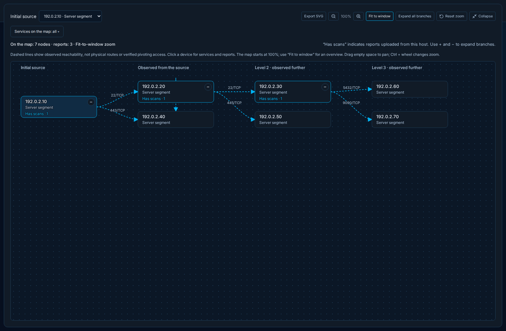](docs/images/gallery/08-network-map-dark.png)

*Actual WebScanner interface in dark mode. Browser captures use synthetic API fixtures; no real organization data is shown.*

<!-- WEBSCANNER_GALLERY_START -->
## Interface gallery

All scenes use the same dark theme. Click any image for the full-size capture. [All 14 screens, including DNS, screenshot viewer and project import →](docs/gallery.md)

<table>
<tr>
<td width="50%"><a href="docs/images/gallery/02-scan-results-dark.png">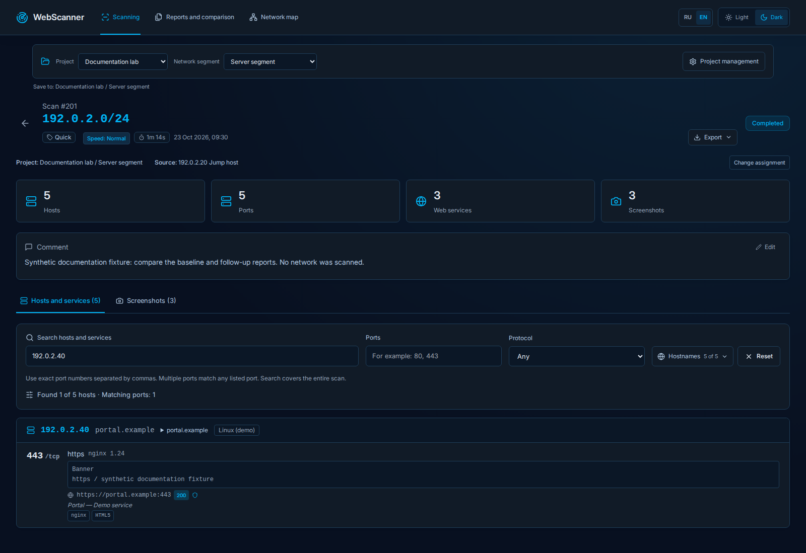</a><br><strong>Scan details and host filters</strong></td>
<td width="50%"><a href="docs/images/gallery/03-host-card-dark.png">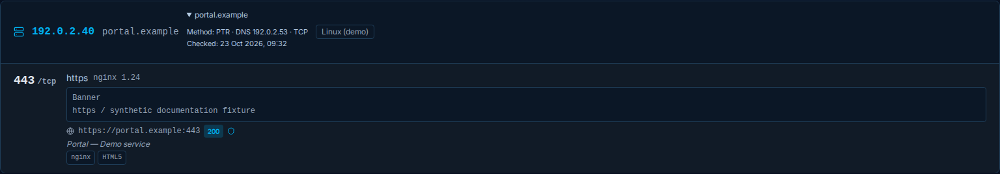</a><br><strong>Host card, DNS evidence and web metadata</strong></td>
</tr>
<tr>
<td width="50%"><a href="docs/images/gallery/05-screenshot-gallery-dark.png">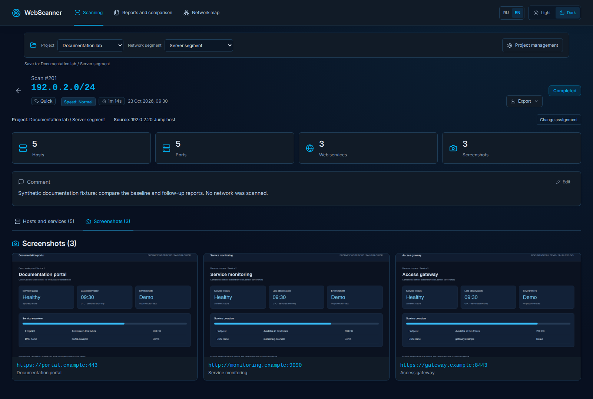</a><br><strong>Web-service screenshot gallery</strong></td>
<td width="50%"><a href="docs/images/gallery/07-comparison-dark.png">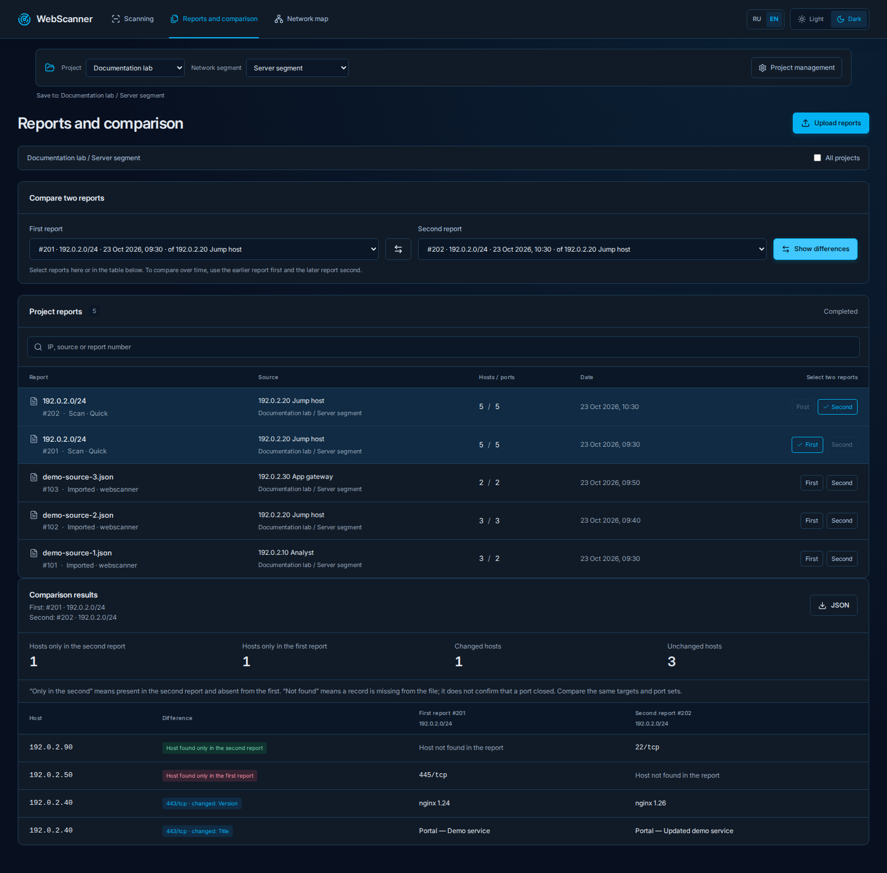</a><br><strong>Before and after report comparison</strong></td>
</tr>
<tr>
<td width="50%"><a href="docs/images/gallery/09-neighborhood-dark.png">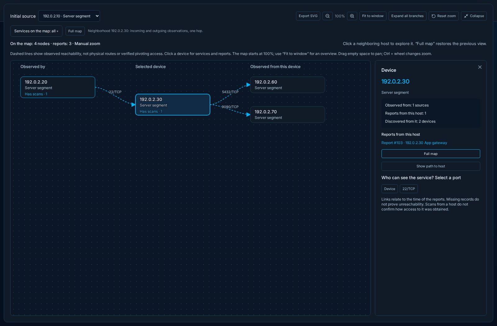</a><br><strong>Incoming and outgoing host observations</strong></td>
<td width="50%"><a href="docs/images/gallery/10-service-visibility-dark.png">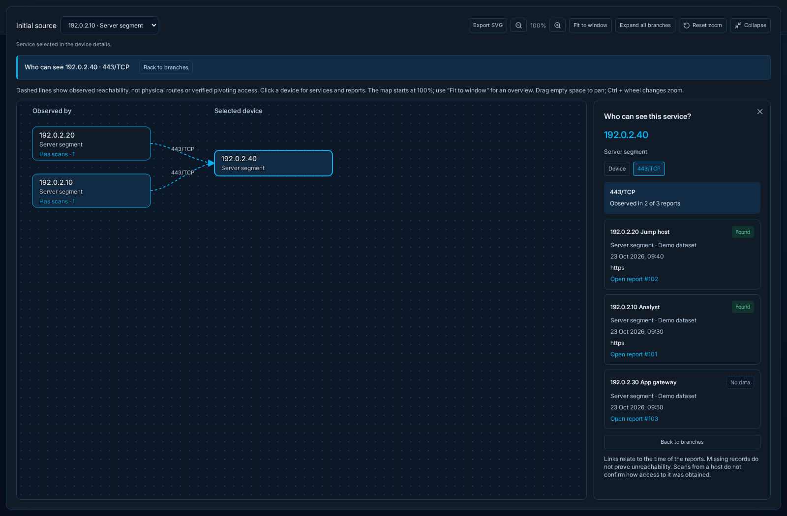</a><br><strong>Who observed this service?</strong></td>
</tr>
<tr>
<td width="50%"><a href="docs/images/gallery/11-observation-path-dark.png">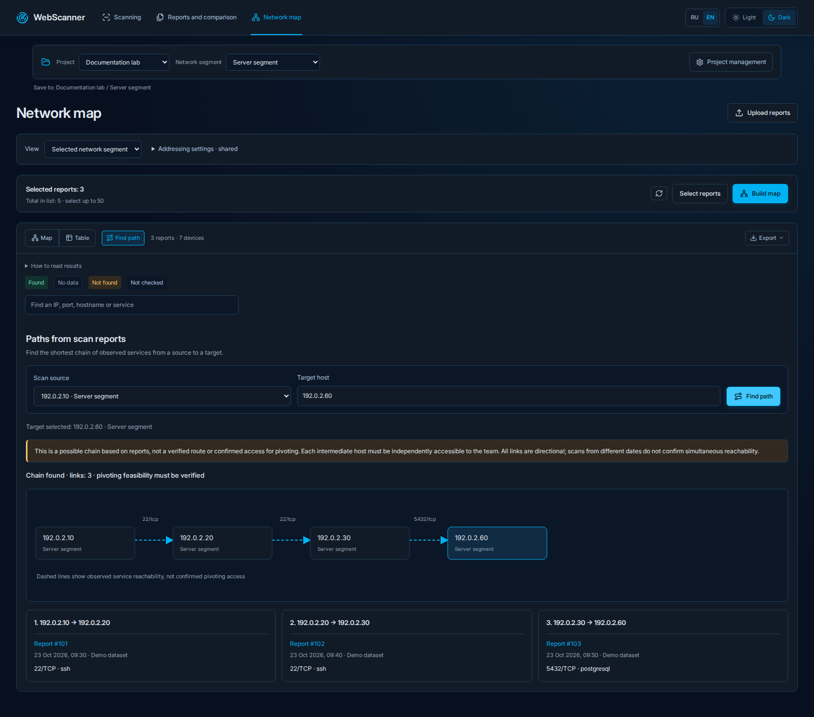</a><br><strong>Directed observation path and evidence</strong></td>
<td width="50%"><a href="docs/images/gallery/12-evidence-table-dark.png">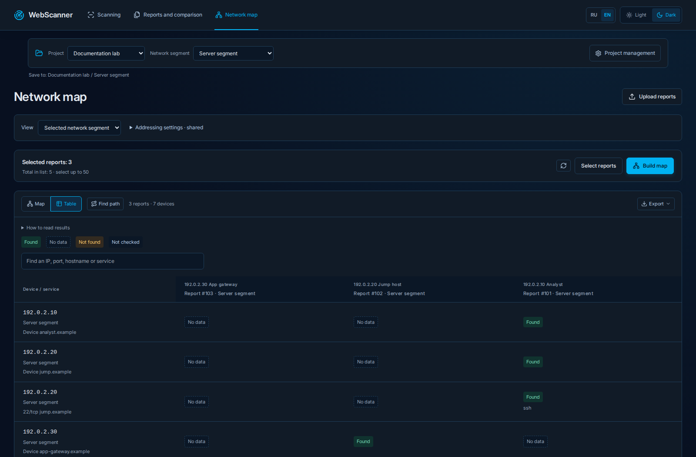</a><br><strong>Source-by-service evidence matrix</strong></td>
</tr>
</table>
<!-- WEBSCANNER_GALLERY_END -->

## Why the graph matters

A scan from an analyst's host and a scan from an application gateway can reveal different services. WebScanner keeps those viewpoints separate while showing their relationships.

In the example above:

- The analyst sees SSH on the jump host and HTTPS on the portal.
- The jump host sees the application gateway, the same portal and the file server.
- The application gateway sees PostgreSQL and a monitoring service.

The graph exposes the observation chain **Analyst → Jump host → Application gateway → Database**. It also shows that multiple sources saw the same portal.

| Service | Analyst | Jump host | App gateway |
| --- | --- | --- | --- |
| Portal · `192.0.2.40:443` | Observed | Observed | No data |
| File server · `192.0.2.50:445` | No data | Observed | No data |
| PostgreSQL · `192.0.2.60:5432` | No data | No data | Observed |

**A connection is report evidence, not a physical cable or confirmed pivoting access.** “No data” means the selected reports do not establish an observation. It does not establish that a host is unreachable or a port is closed.

## Explore the map

| Question | What to use |
| --- | --- |
| What was observed from this source? | Select a source, expand or collapse branches, and filter by service. |
| Who observed this host, and what did it observe? | Open the host neighborhood for incoming and outgoing observations. |
| Which sources found a specific service? | Select a port in the device details to see the reports behind it. |
| Is there an observation chain between two devices? | Find the shortest directed path across the selected reports. |
| How do different scans compare? | Switch to the source-by-service evidence table or compare two reports. |
| Can I share the result? | Export the current view or full map to SVG, download JSON, or transfer the whole project as ZIP. |

Scope the map to one network segment or the whole project. Identical IPs can stay separate for isolated address spaces or be deliberately merged for a shared network. Reports retain their source, author and observation time.

[Map controls and limitations →](docs/network-map.md) · [SVG and project transfer →](docs/project-transfer.md)

## Try it without scanning a network

1. [Download the demo project archive](examples/demo-project.zip).
2. In WebScanner, open **Project management → Import project** and select the ZIP.
3. Open **Network map**, select the demo project and **Documentation lab**.
4. Use **Project management → Project description → Open saved map**, or select all three reports and build the map.

The archive contains constructed reports and their original JSON files. Importing it does not start a scan. [Demo details, addresses and expected results →](examples/README.md)

## From scan to shared evidence

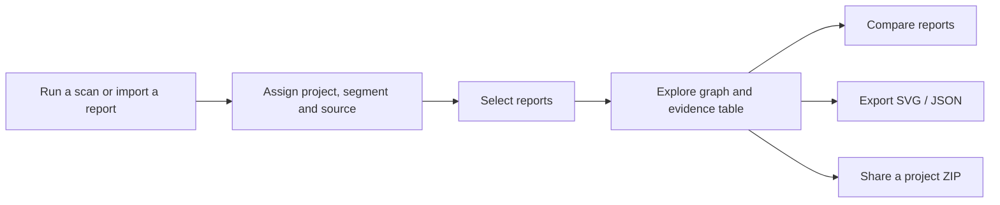

### More than a map

- **Active TCP scanning:** RustScan → Nmap verification → service detection → httpx → Gowitness screenshots.
- **Report imports:** Nmap, Masscan, RustScan, FastScan, CSV and WebScanner formats.
- **Scan history:** progress, cancellation, retry, port profiles and exclusions.
- **Host investigation:** DNS names, exact port/protocol filters, services, versions and web metadata.
- **Project organization:** network segments, scan sources, authors, comments and observation dates.
- **RU / EN interface:** light and dark themes, with a **24-hour clock** in both languages.
- **CLI:** create projects, submit scans, inspect status, retry and import reports from the terminal.

## Run locally

Requires Docker Engine with the Compose plugin. The scanner Dockerfile downloads **Linux amd64** binaries.

```sh
cp .env.example .env
# Set your own URL-safe POSTGRES_PASSWORD in .env.
# You can generate one with: openssl rand -hex 24
mkdir -p scans
docker compose up --build -d
```

Open **http://localhost:3000**. The first build installs RustScan, Chromium and other scanner tools.

The provided Compose file binds to `127.0.0.1`. There is no application authentication; use a controlled environment. Scans run from the worker container, not the browser or CLI machine. Assess only networks you own or are authorized to test.

## Architecture and storage

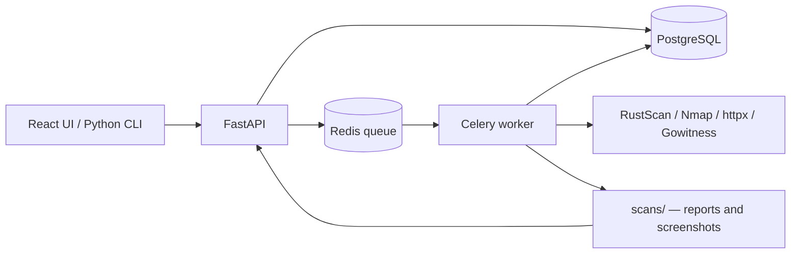

Back up **PostgreSQL and `scans/` together**. `docker compose down -v` deletes the database volume. Keep an existing installation's Compose project name and database credentials when updating it.

## Documentation and development

| Guide | Contents |
| --- | --- |
| [Detailed Russian guide](docs/guide.ru.md) | Scan profiles, imports, comparison, limits and updates |
| [Network map](docs/network-map.md) | Branches, neighborhoods, service filters and evidence |
| [Project transfer](docs/project-transfer.md) | SVG export, complete project archives and saved maps |
| [CLI](docs/cli.md) | Command-line usage |
| [DNS](docs/dns.md) | Hostname resolution and its limits |
| [Languages](docs/languages.md) | RU / EN and 24-hour formatting |
| [Validation](docs/validation.md) | What has and has not been checked |

```sh
python3 -m venv .venv
. .venv/bin/activate
pip install -r backend/requirements.txt
PYTHONPATH=backend python3 -m unittest discover -s backend/tests -v
python3 scripts/check_retry_api.py

cd frontend
npm install
npm test
npm run typecheck
npm run build
```

Python 3.11+ and Node.js 20+. A local Vite process outside Compose needs its API proxy adjusted from `backend:8000` to the local backend address.

## License

An application source license has not been selected yet. [Third-party notices](THIRD_PARTY_NOTICES.md) cover bundled fonts and installed dependencies.
