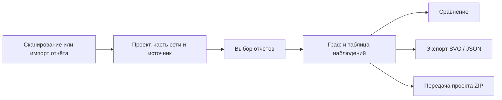

# WebScanner

**Объединяйте отдельные сетевые обследования в карту наблюдаемой доступности сервисов.**

Сканируйте из разных точек, собирайте отчёты в проект и исследуйте, откуда обнаружены устройства и сервисы. За связями сохраняются исходные отчёты, источники и время проверки.

**[English](README.md)** · [Открыть демопроект](examples/README.md) · [Руководство по карте](docs/network-map.md) · [CLI](docs/cli.md)

[](docs/images/gallery/08-network-map-dark.png)

*Настоящий интерфейс WebScanner в тёмной теме. Кадры сняты браузером на демонстрационных ответах API; реальных данных организаций здесь нет.*

<!-- WEBSCANNER_GALLERY_START -->
## Интерфейс программы

Все кадры сняты в одной тёмной теме. Нажмите на изображение, чтобы открыть его целиком. [Все 14 экранов: DNS, просмотр скриншотов, описание и импорт проекта →](docs/gallery.md)

<table>
<tr>
<td width="50%"><a href="docs/images/gallery/02-scan-results-dark.png"></a><br><strong>Результаты скана и фильтры</strong></td>
<td width="50%"><a href="docs/images/gallery/03-host-card-dark.png"></a><br><strong>Карточка хоста, DNS и веб-метаданные</strong></td>
</tr>
<tr>
<td width="50%"><a href="docs/images/gallery/05-screenshot-gallery-dark.png"></a><br><strong>Галерея скриншотов сервисов</strong></td>
<td width="50%"><a href="docs/images/gallery/07-comparison-dark.png"></a><br><strong>Сравнение двух отчётов</strong></td>
</tr>
<tr>
<td width="50%"><a href="docs/images/gallery/09-neighborhood-dark.png"></a><br><strong>Окружение хоста</strong></td>
<td width="50%"><a href="docs/images/gallery/10-service-visibility-dark.png"></a><br><strong>Кто видит сервис?</strong></td>
</tr>
<tr>
<td width="50%"><a href="docs/images/gallery/11-observation-path-dark.png"></a><br><strong>Путь по наблюдениям и отчёты</strong></td>
<td width="50%"><a href="docs/images/gallery/12-evidence-table-dark.png"></a><br><strong>Матрица доступности</strong></td>
</tr>
</table>
<!-- WEBSCANNER_GALLERY_END -->

## Зачем нужна такая карта

Скан с компьютера исследователя и скан со шлюза приложения могут дать разные результаты. WebScanner показывает эти точки наблюдения вместе, сохраняя происхождение каждой связи.

В примере на картинке:

- Исследователь обнаружил SSH промежуточного хоста и HTTPS портала.
- Промежуточный хост обнаружил шлюз приложения, тот же портал и файловый сервер.
- Шлюз приложения обнаружил PostgreSQL и сервис мониторинга.

На графе видна цепочка наблюдений **Исследователь → Промежуточный хост → Шлюз приложения → База данных**. При этом один портал обнаружен из двух разных источников.

| Сервис | Исследователь | Промежуточный хост | Шлюз приложения |
| --- | --- | --- | --- |
| Портал · `192.0.2.40:443` | Обнаружено | Обнаружено | Нет данных |
| Файловый сервер · `192.0.2.50:445` | Нет данных | Обнаружено | Нет данных |
| PostgreSQL · `192.0.2.60:5432` | Нет данных | Нет данных | Обнаружено |

**Связь на графе — наблюдение из отчёта, а не физическое соединение или доказанный доступ для перехода.** «Нет данных» не означает, что хост недоступен или порт закрыт.

## Что можно исследовать

| Задача | Возможность |
| --- | --- |
| Посмотреть, что обнаружено из конкретной точки | Выбор начального источника, раскрытие веток и фильтр сервисов |
| Изучить окружение хоста | Входящие и исходящие наблюдения вокруг выбранного устройства |
| Узнать, кто обнаружил конкретный сервис | Выбор порта в карточке и просмотр исходных отчётов |
| Найти цепочку наблюдений между устройствами | Поиск кратчайшего направленного пути по выбранным отчётам |
| Сопоставить точки и результаты обследований | Матрица доступности и сравнение двух отчётов |
| Передать результат другому человеку | SVG текущего вида или всей карты, JSON либо ZIP целого проекта |

Карта строится по выбранной части сети или всему проекту. Одинаковые IP можно сохранять раздельно для изолированных сетей либо явно объединить при общей адресации. Источники, авторы и даты отчётов остаются доступны.

[Подробно об управлении картой →](docs/network-map.md) · [Экспорт и перенос проектов →](docs/project-transfer.md)

## Попробовать без сканирования сети

1. [Скачайте архив демопроекта](examples/demo-project.zip).
2. В WebScanner откройте **Управление проектом → Импорт проекта** и выберите ZIP.
3. Перейдите в **Карту сети**, выберите демопроект и часть **Documentation lab**.
4. Нажмите **Управление проектом → Описание проекта → Открыть сохранённую карту** либо выберите три отчёта и постройте карту.

Демо содержит искусственно составленные отчёты и исходные JSON-файлы. Импорт ничего не сканирует. [Состав и ожидаемый результат →](examples/README.md)

## Рабочий процесс



## Остальные возможности

- **TCP-сканирование:** RustScan → проверка Nmap → определение сервисов → httpx → скриншоты Gowitness.
- **Импорт отчётов:** Nmap, Masscan, RustScan, FastScan, CSV и форматы WebScanner.
- **История запусков:** прогресс, отмена, повтор, профили портов и исключения.
- **Работа с хостами:** DNS-имена, точные фильтры портов и протоколов, сервисы, версии и веб-метаданные.
- **Организация обследования:** проекты, части сети, источники, авторы, комментарии и время наблюдений.
- **Русский и английский интерфейс**, светлая и тёмная темы. Время в обоих языках — **24-часовое**, без AM/PM.
- **CLI** для работы из терминала через общий API.

## Запуск

Нужны Docker Engine и плагин Compose. Dockerfile сканера загружает инструменты для **Linux amd64**.

```sh
cp .env.example .env
# Укажите собственный POSTGRES_PASSWORD из URL-безопасных символов.
# Сгенерировать значение можно командой: openssl rand -hex 24
mkdir -p scans
docker compose up --build -d
```

Интерфейс: **http://localhost:3000**. Первая сборка устанавливает RustScan, Chromium и другие инструменты.

Готовая конфигурация привязывает интерфейс к `127.0.0.1`. Авторизации в приложении нет; используйте контролируемое окружение. Сканирование выполняет worker, а не компьютер с браузером или CLI. Обследуйте только собственные сети или сети, на проверку которых получено разрешение.

## Документация

| Руководство | Содержание |
| --- | --- |
| [Подробное руководство](docs/guide.ru.md) | Профили, импорт, сравнение, ограничения и обновление |
| [Карта сети](docs/network-map.md) | Ветки, окружение, сервисы и доказательства наблюдений |
| [Перенос проектов](docs/project-transfer.md) | SVG, ZIP проекта и сохранённая карта |
| [CLI](docs/cli.md) | Команды и примеры |
| [DNS](docs/dns.md) | Определение имён и ограничения |
| [Языки](docs/languages.md) | RU / EN и формат времени |
| [Проверки](docs/validation.md) | Подтверждённые проверки и ограничения прогона |

База хранится в PostgreSQL volume, исходные файлы и скриншоты — в `scans/`. Для резервной копии нужны **оба хранилища**. `docker compose down -v` удаляет том базы. При обновлении существующей установки сохраняйте её имя Compose-проекта и учётные данные БД.

Лицензия исходного кода приложения пока не выбрана. [Сторонние компоненты](THIRD_PARTY_NOTICES.md).
