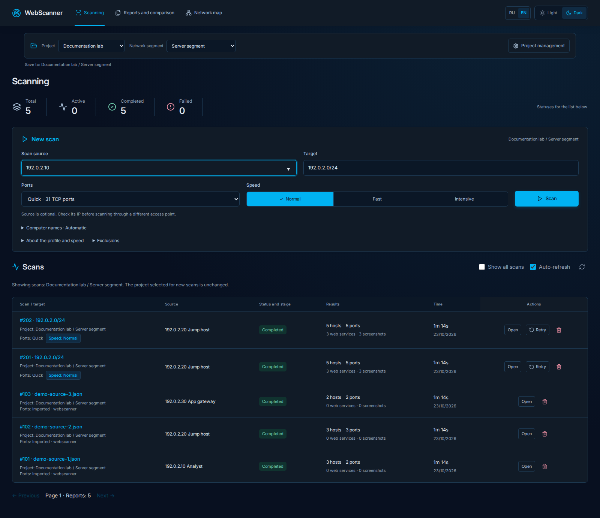
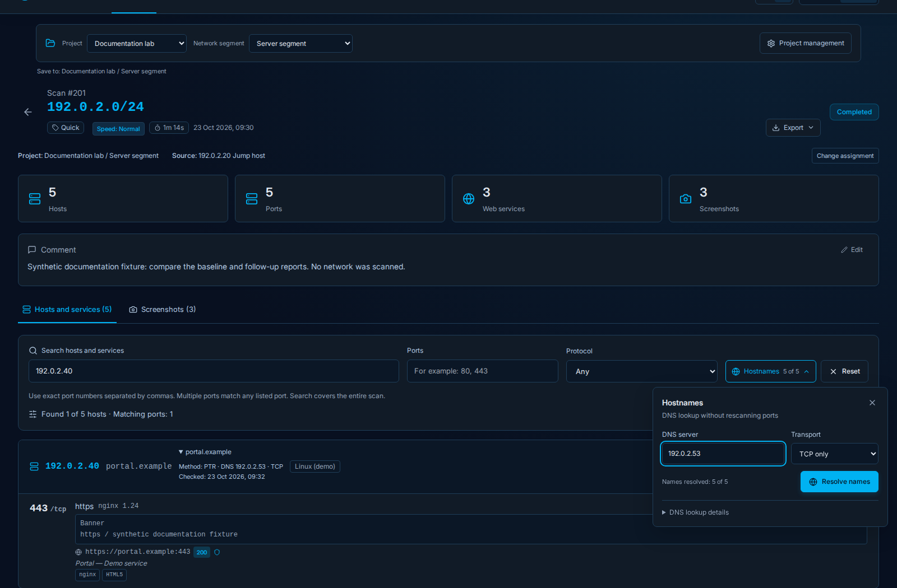
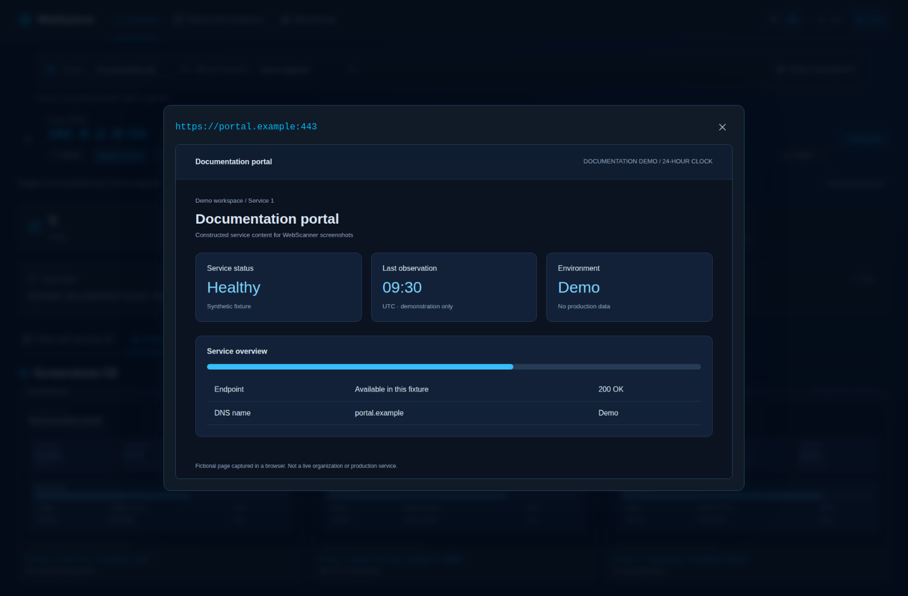
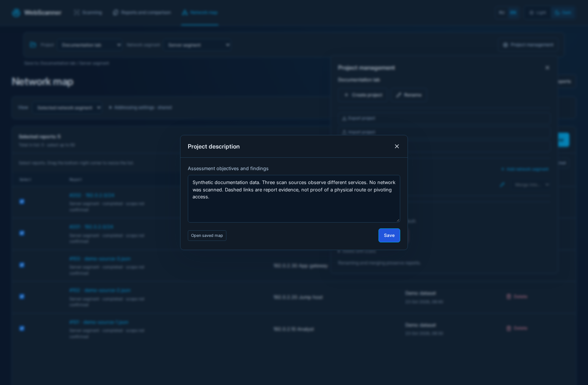
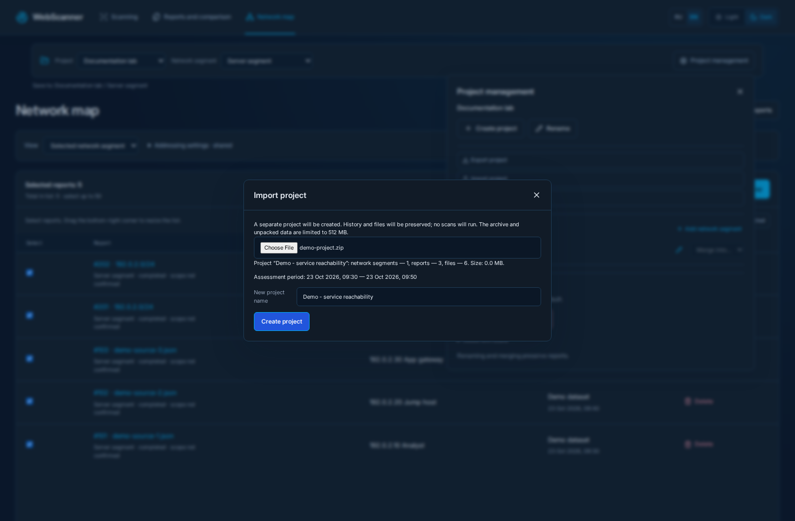

# WebScanner — dark interface gallery

Real WebScanner UI captured in Chromium with intercepted synthetic API fixtures. All fourteen scenes use dark mode, an English interface and UTC with a 24-hour clock. No production projects were read or modified.

**[Contact sheet](images/gallery/contact-sheet-dark.png)** · [Capture manifest](images/gallery/manifest.json) · [Capture procedure](gallery-capture.md)

## Scan overview / Обзор сканирования

## Scan details and host filters / Результаты скана и фильтры

## Host card, DNS evidence and web metadata / Карточка хоста, DNS и веб-метаданные

## Compact DNS lookup controls / Компактные настройки DNS

## Web-service screenshot gallery / Галерея скриншотов сервисов

## Full screenshot viewer / Просмотр скриншота

## Before and after report comparison / Сравнение двух отчётов

## Multilevel service reachability map / Многоуровневая карта

## Incoming and outgoing host observations / Окружение хоста

## Who observed this service? / Кто видит сервис?

## Directed observation path and evidence / Путь по наблюдениям и отчёты

## Source-by-service evidence matrix / Матрица доступности

## Project description and saved map / Описание проекта и сохранённая карта

## Project archive import preview / Предпросмотр импорта проекта

